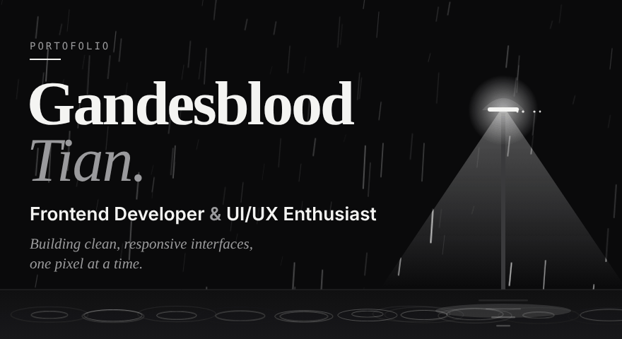

<p align="center">
  <a href="#tentang"></a>
  <a href="#keahlian"></a>
  <a href="#proyek"></a>
  <a href="#perjalanan"></a>
  <a href="#prinsip"></a>
  <a href="#aktivitas"></a>
  <a href="#kontak"></a>
</p>

<br/>

<a id="tentang"></a>
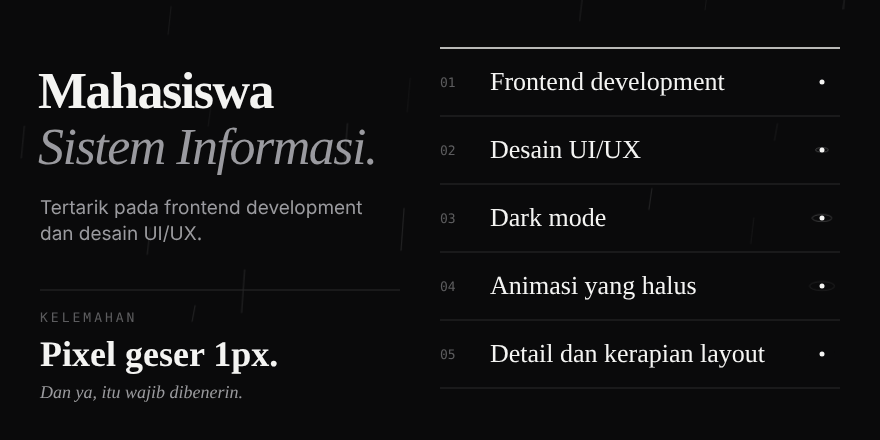

Mahasiswa Sistem Informasi yang tertarik pada **frontend development** dan **desain UI/UX**. Suka dark mode, animasi yang halus, dan layout yang rapi, dengan perhatian ke detail kecil (termasuk pixel yang geser 1px).

<br/>

<a id="keahlian"></a>
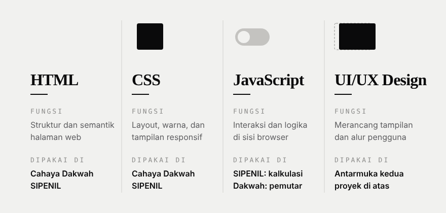

| Teknologi | Fungsi | Dipakai di |
| --- | --- | --- |
| HTML | Struktur dan semantik halaman web | Cahaya Dakwah, SIPENIL |
| CSS | Layout, warna, dan tampilan responsif | Cahaya Dakwah, SIPENIL |
| JavaScript | Interaksi dan logika di sisi browser | SIPENIL (kalkulasi nilai), Cahaya Dakwah (pemutar kajian) |
| UI/UX Design | Merancang tampilan dan alur pengguna | Antarmuka kedua proyek di atas |

<details>
<summary><b>Intip jurus gue</b> &nbsp;·&nbsp; bikin hujan pakai CSS, klik buat buka</summary>

<br/>

**CSS: tetes hujan jatuh pelan, dan berhenti buat yang gak suka animasi**

```css
.hujan {
  position: relative;
  overflow: hidden;
  background: #0a0a0b;
}

.hujan i {
  position: absolute;
  top: -10%;
  width: 1px;
  height: 60px;
  background: linear-gradient(transparent, #f4f4f2);
  animation: jatuh 1.8s linear infinite;
}

@keyframes jatuh {
  to { transform: translateY(120vh); }
}

@media (prefers-reduced-motion: reduce) {
  .hujan i { animation: none; }
}
```

**JavaScript: sebar tetesnya biar acak**

```js
document.querySelectorAll(".hujan i").forEach((tetes) => {
  tetes.style.left = Math.random() * 100 + "%";
  tetes.style.animationDelay = Math.random() * 2 + "s";
});
```

</details>

<br/>

<a id="proyek"></a>

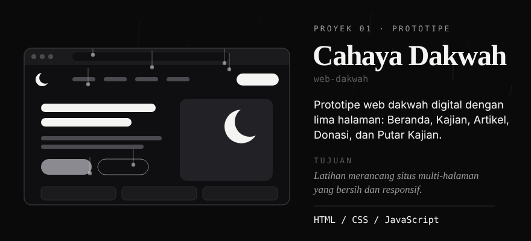

**Cahaya Dakwah** · [Live Demo](https://bovisebastianp-tech.github.io/web-dakwah/) · [Source Code](https://github.com/bovisebastianp-tech/web-dakwah)

<details>
<summary>Yang ada di dalamnya</summary>

- Lima halaman: Beranda, Kajian, Artikel, Donasi, dan Putar Kajian.
- Artikel dengan filter kategori dan tombol simpan bacaan.
- Donasi dengan pilihan nominal dan kolom nominal lain.
- Statusnya prototipe.

</details>

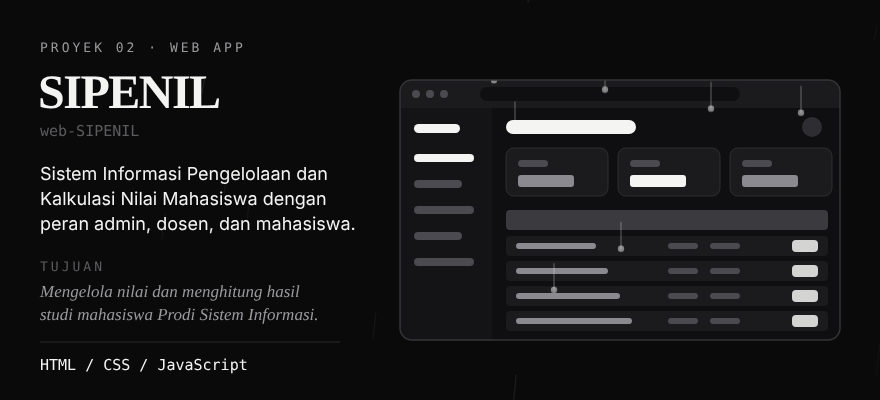

**SIPENIL** · [Live Demo](https://bovisebastianp-tech.github.io/web-SIPENIL/) · [Source Code](https://github.com/bovisebastianp-tech/web-SIPENIL)

<details>
<summary>Yang ada di dalamnya</summary>

- Tiga peran pengguna: admin, dosen, dan mahasiswa.
- Admin mengelola data mahasiswa, dosen, dan mata kuliah, serta bisa mencetak KHS.
- Bobot nilai bisa diatur dan disimpan.

</details>

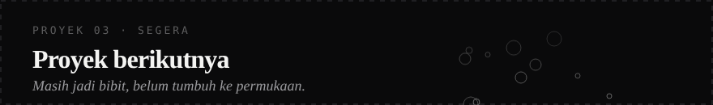

<br/>

<a id="perjalanan"></a>
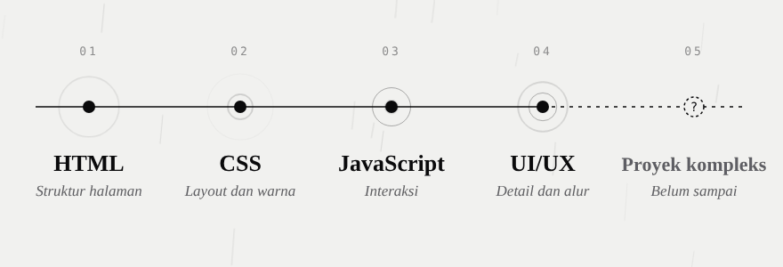

<br/>

<a id="prinsip"></a>
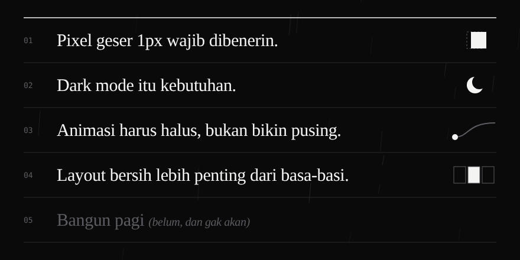

<br/>

<a id="aktivitas"></a>

<p align="center">
  
</p>

<p align="center">
  <picture>
    <source media="(prefers-color-scheme: dark)" srcset="https://raw.githubusercontent.com/bovisebastianp-tech/bovisebastianp-tech/output/github-snake-dark.svg" />
    <source media="(prefers-color-scheme: light)" srcset="https://raw.githubusercontent.com/bovisebastianp-tech/bovisebastianp-tech/output/github-snake.svg" />
    
  </picture>
</p>

<br/>

<a id="kontak"></a>
<a href="https://github.com/bovisebastianp-tech">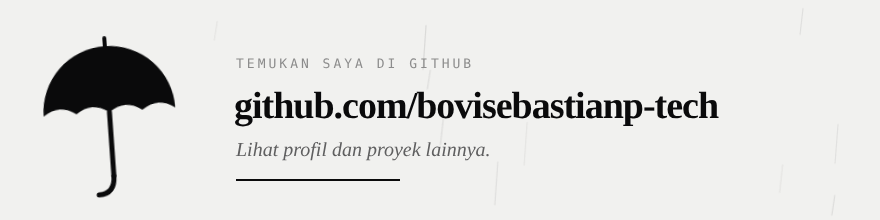</a>

GitHub: [github.com/bovisebastianp-tech](https://github.com/bovisebastianp-tech)

<br/>

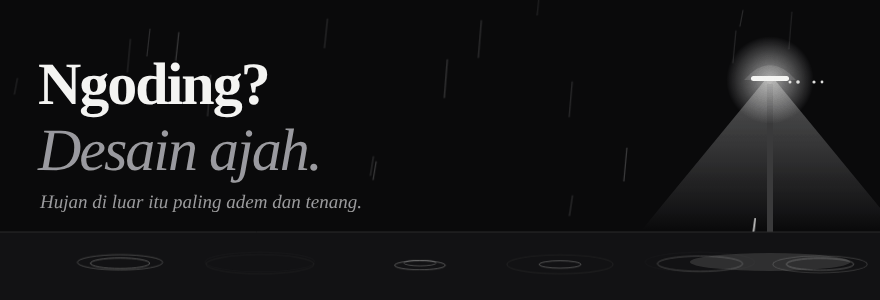
