<div align="center">




<br/>


<br/><br/>

✦ ˚ 🌙 ˚ ✦ ˚ ⋆ ˚ ✦

> *"Mahasiswa Sistem Informasi. Lebih mahir desain UI/UX.*
> *Yang penting tampilan rapi dan responsif, abis itu tidur."* 🌌

</div>


<h2 align="center">🌊 Tentang Gue</h2>

```js
const gandesblood = {
  nama: "Gandesblood Tian",
  peran: "Frontend Developer",
  jamAktif: "20.00 – 22.00",
  lagiDibikin: "tampilan web yang rapi, responsif, dan enak dipandang",
  suka: ["dark mode", "animasi halus", "layout yang bersih"],
  kelebihan: ["sabar", "teliti", "mata tajam soal detail"],
  kelemahan: ["Tugas numpuk", "pixel yang geser 1px"],

  sapa() {
    return "Ssst… udah lewat tengah malam, ya?";
  },
};
```

<div align="center">

**🕛 Jam terbang gue dalam sehari**

</div>

```text
JAM   00          06          12          18        23
      ████████████░░░░░░░░░░░░░░░░░░░░░░░░░░░░░░░░░░██
```

<div align="center">

`█` 🌙 online &nbsp;·&nbsp; `░` ☀️ zona terlarang

</div>


<h2 align="center">🐚 Tech Stack</h2>

<div align="center">


<br/><br/>

| Lapisan | Bahasa | Dipakai buat |
| :-----: | :----: | :----------- |
| 🪸 Dasar laut | **HTML** | Struktur halaman yang rapi dan semantik |
| 🌊 Air & arus | **CSS** | Layout, warna, responsif, dan animasi |
| ⚡ Denyut | **JavaScript** | Bikin halaman jadi interaktif |

</div>

<details>
<summary>🔍 <b>Intip jurus gue</b> (klik buat nyelam)</summary>

<br/>

**🎨 CSS: laut yang bergerak halus, dan tetap sopan buat yang gak suka animasi**

```css
.laut {
  background: linear-gradient(180deg, #0a1628 0%, #0b4f7a 50%, #00b4d8 100%);
  background-size: 100% 200%;
  animation: pasang 8s ease-in-out infinite alternate;
}

@keyframes pasang {
  from { background-position: 0 0; }
  to   { background-position: 0 100%; }
}

@media (prefers-reduced-motion: reduce) {
  .laut { animation: none; }
}
```

**⚡ JavaScript: sapaan sesuai jam aktif**

```js
const jam = new Date().getHours();
const jamAktif = jam >= 23 || jam < 6;

console.log(jamAktif ? "🌙 Gue lagi online." : "☀️ Zzz… jangan diganggu.");
```

</details>


<h2 align="center">🚀 Proyek</h2>

<div align="center">

| 🌐 Proyek | 📝 Keterangan | 🛠️ Dibuat dengan |
| :-------: | :------------ | :---------------: |
| [**web-dakwah**](https://github.com/bovisebastianp-tech/web-dakwah) | Web tugas, tempat latihan bikin tampilan | `HTML` |

<sub>Proyek berikutnya masih di dasar laut, belum muncul ke permukaan 🌊</sub>

</div>


<h2 align="center">🧭 Kode Etik Tengah Malam</h2>

- [x] Pixel geser 1px itu wajib dibenerin
- [x] Dark mode itu bukan pilihan, itu kebutuhan
- [x] Animasi harus halus, bukan bikin pusing
- [x] Layout bersih lebih penting dari basa-basi
- [ ] Bangun pagi *(belum, dan gak akan)*


<h2 align="center">📊 Statistik</h2>

<div align="center">


<br/>


</div>


<h2 align="center">🌌 Grafik Aktivitas</h2>

<div align="center">


<br/>

<picture>
  <source media="(prefers-color-scheme: dark)" srcset="https://raw.githubusercontent.com/bovisebastianp-tech/bovisebastianp-tech/output/github-snake-dark.svg" />
  <source media="(prefers-color-scheme: light)" srcset="https://raw.githubusercontent.com/bovisebastianp-tech/bovisebastianp-tech/output/github-snake.svg" />
  
</picture>

</div>


<h2 align="center">📬 Kontak</h2>

<div align="center">

<a href="https://github.com/bovisebastianp-tech"></a>
<a href="https://github.com/bovisebastianp-tech?tab=followers"></a>

<br/><br/>

<sub>🌌 Fun fact: zona "tengah malam" di laut itu paling indah untuk di lihat.</sub>

<br/><br/>


</div>
